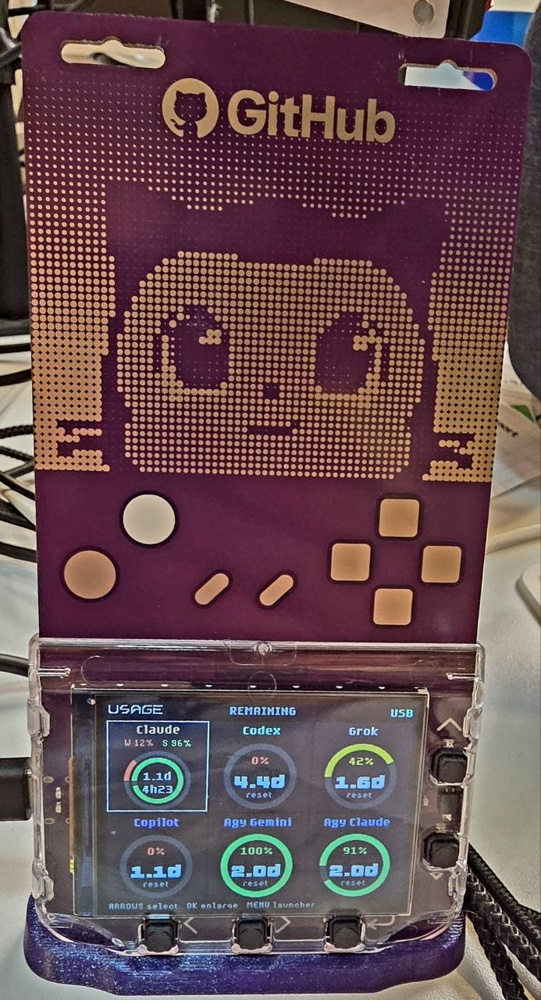
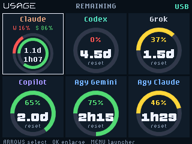

# Universe Usage Board

Turn your **GitHub Universe 2026 badge** into an always-on display for your AI coding subscriptions, powered by [OpenUsage](https://github.com/robinebers/openusage) on your Mac.

<p align="center">
  
</p>

*The finished board running on a GitHub Universe 2026 badge.*

## Reading the board



Every ring shows **allowance remaining**. Full is 100% left; empty means that allowance is exhausted. Purchased credit balances are available in the detail view.

| Color | Remaining allowance |
| --- | --- |
| Green | More than 50% |
| Yellow | 21–50% |
| Red | 0–20% |
| Gray | Stale, unavailable, or sign-in required |

Displayed percentages are rounded to whole numbers; the color bands use those same rounded values.

The six-tile layout shows Claude, Codex, Grok, Copilot, Antigravity Gemini, and Antigravity Claude. It follows the providers enabled in OpenUsage; additional providers/accounts get further pages.

**Claude combines two rings:** weekly on the outside, five-hour session on the inside. The top reset countdown corresponds to the outer ring; the bottom corresponds to the inner ring. Countdown units are `d` days, `h` hours, and `m` minutes: `1.1d` is about 26 hours, and `1h07` is one hour and seven minutes. The small W/S percentage legend identifies weekly/session remaining allowance.

The badge boots directly into the board, stays at 80% brightness while USB-powered, and sleeps after two seconds without USB power. No Wi-Fi setup, NAS, or firmware flashing is required.

## What you need

- A **GitHub Universe 2026 Badger 2350**, running its stock MicroPython firmware. The older Universe 2025/e-ink badges use different APIs and are not supported.
- A Mac running OpenUsage, with the providers you want enabled and signed in.
- A USB-C **data** cable, Python 3.10+, and Git. Examples below use [uv](https://docs.astral.sh/uv/); `python3 -m venv` and pip work too.

**Buy the base hardware:** [Pimoroni Tufty 2350](https://shop.pimoroni.com/en-us/products/tufty-2350?variant=55811986194811). The Universe 2026 badge is a [custom version of this board](https://github.com/badger/home/blob/main/hardware/README.md); this project has been tested on the Universe firmware. Compatibility with the stock retail firmware has not yet been verified.

Tested on the physical Badger 2350 with MicroPython 1.29.0-preview, firmware build 2026-10-13, and OpenUsage 0.7.13-beta.2. Other OpenUsage versions should work if they provide the `openusage.limits.v1` schema; they have not all been tested.

## Install

### 1. Get the project

```sh
git clone https://github.com/jbaruch/universe-usage-board.git
cd universe-usage-board
uv venv .venv
uv pip install --python .venv/bin/python -r requirements.txt
```

Keep the checkout at this location after installing the Mac login helper.

### 2. Copy the app to the badge

Stop an existing bridge before using USB serial tools:

```sh
launchctl bootout gui/$(id -u) ~/Library/LaunchAgents/com.jbaruch.agent-usage-board.plist
```

Skip that command on a first install. Put the badge in **USB Disk Mode** by opening its Mass Storage app or quickly double-pressing RESET. Wait for the **BADGER** volume to appear. Do not copy app files to the **RP2350** bootloader drive.

Preview the installation, then apply it:

```sh
python3 tools/deploy_badge.py --autostart
python3 tools/deploy_badge.py --autostart --write
diskutil eject /Volumes/BADGER
```

Use `--mount /path/to/BADGER` if the volume has a different name. Ejection normally reboots the badge; press RESET if needed.

The installer preserves the vendor startup in `usage-board-original.py`, backs up an existing version of this app in `.badge-app-backups/`, and refuses to overwrite an unrelated custom startup. Omit `--autostart` to install the app for manual launch only.

**Optional menu icon:** the app includes an icon, but some stock menus ignore custom PNG icons. The [official badge skill's menu-icon patch](https://github.com/badger/home/blob/main/.github/skills/hyb26-skill/references/menu-icons.md) enables it. This affects the launcher tile, not the dashboard or autostart.

### 3. Start the Mac helper

```sh
.venv/bin/python mac/install_bridge.py
```

It starts immediately and runs at login. It discovers the Universe 2026 badge by USB vendor/product ID, reconnecting after unplugging or a reset. When several badges are connected, pin one using `--serial-number YOUR_BADGE_SERIAL`.

OpenUsage should remain running to fetch fresh provider data. Within a few seconds the board should show **USB** and your enabled providers. Provider readings follow OpenUsage's refresh schedule; the bridge sends a snapshot once a minute.

For foreground use instead of a login agent:

```sh
.venv/bin/python mac/usage_bridge.py
```

Do not run the foreground bridge and login helper simultaneously.

## Controls

| Control | Action |
| --- | --- |
| Left / right | Select the adjacent gauge; cross a page boundary to see more gauges |
| Up / down on the matrix | Move between rows |
| Select | Enlarge the selected gauge; select again returns to the matrix |
| Up / down in details | Change metric, including credit balances |
| Back | Return to matrix; from matrix, open the original launcher |
| Menu | Open the original launcher |
| Home / reset | Restart into the board when autostart is installed |
| Hold Menu during startup | Bypass the board and use the original startup/launcher |

Input and display orientation use the badge's logical controls, including its capacitive pads.

## Data and connection behavior


The bridge reads `http://127.0.0.1:6736/v1/limits`, with the bundled OpenUsage CLI as fallback. It mirrors enabled providers and their order from OpenUsage's preferences. The versioned USB packets contain usage summaries, plan names, and reset times; provider credentials remain with OpenUsage on the Mac. Nothing is uploaded to this repository or a hosted service.

The bridge waits for the dashboard's handshake before sending. It does not send dashboard packets into the Python REPL or other badge apps. The badge keeps the last received snapshot in RAM; it does not continuously write usage to flash.

A disconnected bridge becomes stale after three minutes. Provider readings also become stale according to their age and OpenUsage's freshness status. Missing or failed readings are not invented as zero usage. If a provider appears as **SIGN IN**, refresh its login through OpenUsage/the provider's normal sign-in flow.

## Troubleshooting

- **Waiting for Mac / OFFLINE:** use a data-capable cable, keep OpenUsage running, and check the helper log at `~/Library/Logs/AgentUsageBoard/bridge.log`.
- **No current readings:** inspect `.venv/bin/python mac/usage_bridge.py --snapshot` locally. That output contains your usage data; do not paste it into public issues without reviewing it.
- **Serial port busy:** stop the login helper and any foreground bridge before using `mpremote`, Thonny, or a Web Serial tool. Only one process should own the port.
- **Stale after the Mac sleeps:** expected; the last reading stays visible until the Mac resumes and sends a fresh snapshot.
- **App missing from launcher:** check `BADGER/apps/agent_usage/__init__.py`, eject cleanly, and restart.
- **Wrong OpenUsage location:** the fallback helper expects `/Applications/OpenUsage.app`. The local HTTP API is tried first.

## Update, restore, uninstall

To update, stop the helper, pull this repo, repeat the badge-copy steps, and run `mac/install_bridge.py` again. Leave the original startup backup in place.

To restore the stock startup, enter USB Disk Mode and run:

```sh
python3 tools/deploy_badge.py --restore-startup
python3 tools/deploy_badge.py --restore-startup --write
diskutil eject /Volumes/BADGER
```

The dashboard remains available as a manually launched app. If another tool has changed startup since installation, the restore tool refuses to overwrite it; review `usage-board-original.py` and restore manually if appropriate.

To uninstall the Mac helper:

```sh
launchctl bootout gui/$(id -u) ~/Library/LaunchAgents/com.jbaruch.agent-usage-board.plist
rm ~/Library/LaunchAgents/com.jbaruch.agent-usage-board.plist
```

## Development

```sh
python3 -m unittest discover -s tests -v
python3 -m compileall -q mac tools badge tests
```

CI runs these checks without retaining build artifacts. [Validation notes](docs/validation.md) distinguish device checks from automated tests. For badge API and hardware references, use the [official Universe 2026 development skill](https://github.com/badger/home/tree/main/.github/skills/hyb26-skill).

`examples/render_demo.py` renders synthetic demonstration data on the connected badge without installing a different app. Stop the Mac helper first, run it with `mpremote`, and reset the badge/restart the helper afterwards. It leaves a temporary RGB565 capture in `/state/agent-usage-demo.rgb565`; `tools/decode_frame.py` converts a downloaded capture to PNG with Pillow.

## Credits and license

Built for the [GitHub Universe badge](https://github.com/badger/home), made with Pimoroni's badge hardware and MicroPython runtime. Usage readings come from [OpenUsage](https://github.com/robinebers/openusage). This is an independent community project.

[MIT License](LICENSE).
